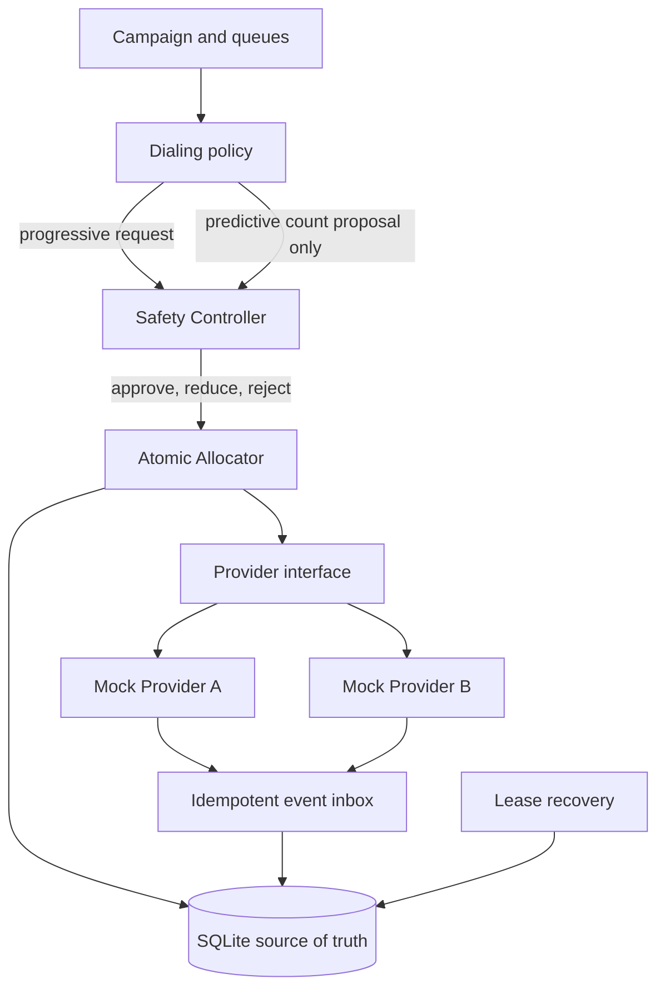

# Architecture

## Component diagram

## Request path

1. The selected policy reads the current snapshot. Progressive requests one dial per free agent. Predictive produces a requested count plus its inputs and calculation; it has no provider dependency.
2. Safety rereads durable state and clamps against available agents, queued borrowers, in-flight limit, and provider health.
3. The allocator starts an immediate SQLite write transaction, reserves one available agent and one queued borrower using conditional updates, and creates a call row with a lease.
4. The call moves to initiated before the adapter receives the call ID. Stable call IDs are the provider idempotency key in a real adapter.
5. Provider events are recorded once by event ID, checked against the call state machine, and applied with their corresponding agent/borrower updates.
6. Lease recovery safely releases pre-initiation reservations. If initiation may have reached the provider, the call enters `RECONCILING` and keeps its agent and borrower until a late event or provider lookup resolves it.

## Concurrency and authority

SQLite `BEGIN IMMEDIATE`, conditional state updates, and partial unique indexes serialize local writers and protect active agent and borrower uniqueness. The database is authoritative; a cache is not used. The Safety Controller makes the final capacity decision, while the allocator enforces reservation correctness even if two callers race after taking snapshots. A production design should make the final safety check and reservation one transaction or require the allocator to enforce the identical hard limits, as the current local prototype does by holding one agent per call.

## Provider behavior

Both mock adapters implement `initiate(call_id) -> events`. Provider A has low failure and predictable outcomes. Provider B introduces timeouts, duplicate event IDs, and an event-order permutation. The event inbox is idempotent. Terminal calls remain terminal; late transitions are stored as ignored. Production adapters should add signature verification, provider-specific event sequence reconciliation, and a query API for uncertain calls.

## Failure policy

- **Worker crash:** reservation leases expire. A pre-initiation reservation can be released safely. An initiated/answered/connected call moves to `RECONCILING`; its agent stays assigned and its borrower is held until a provider event or authoritative lookup resolves it.
- **Provider outage:** three consecutive mock-provider timeouts open its circuit. Safety returns zero approvals while health is false, and the regular simulation stops the rest of an already-approved batch. Existing calls stay tracked. Confirmed failed attempts can return borrowers to queue; production retries still need exponential backoff, jitter, attempt limits, and an automated half-open recovery policy.
- **Agent disappears:** set the agent offline immediately. Because each active call owns an agent reservation, no new calls can claim it. A connected call requires a dedicated transfer/exception policy in production; the prototype does not silently abandon it.
- **Duplicate/out-of-order events:** event ID deduplication and transition validation prevent duplicate effects and stale state regression.

## Scaling expectations

SQLite write locking is the first likely bottleneck as simultaneous campaigns/workers grow. Next are provider rate limits, callback ingestion, and hot campaign queues. At higher scale, partition command processing by campaign, use a row-locking relational store or transactional queue for reservations, partition event processing by provider/call ID, and monitor lock wait, callback lag, provider error rate, and queue age. Preserve the final safety gate and one-agent-per-active-call invariant during migration.

## Timed pacing simulation

The CLI's `--timed` mode runs per-agent simulated timelines. Progressive mode starts setup after an agent's preceding call ends. Predictive mode can pre-dial one next call during that agent's current talk interval, reserving that exact agent's next slot. The simulated answer event occurs at the prior call's end, so connected calls never exceed agents and no answer is bridged without its reserved agent. This isolates setup-overlap utilization gains; it is a simulator policy, not the production `Store` allocator's future-slot implementation.
